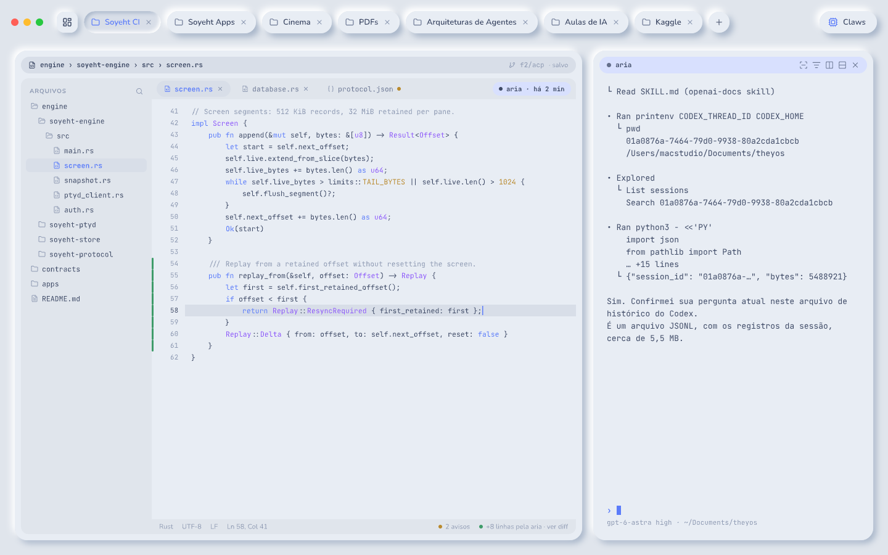
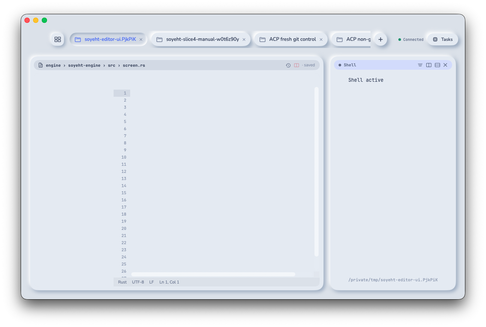
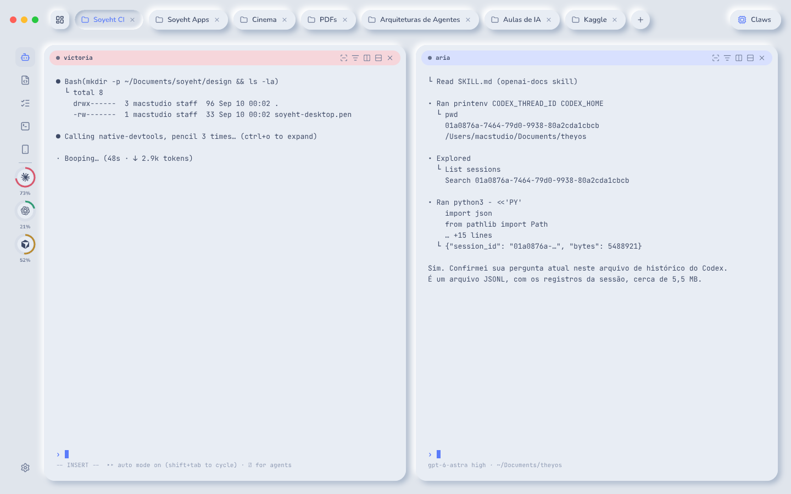
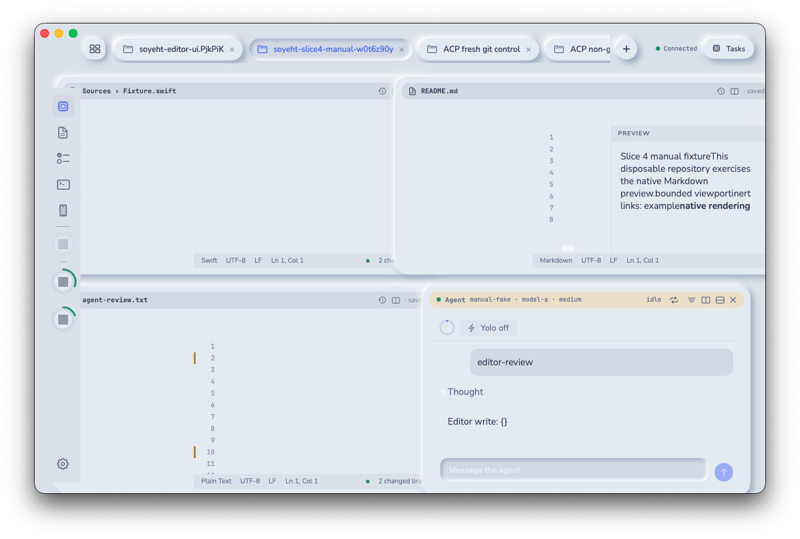
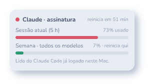
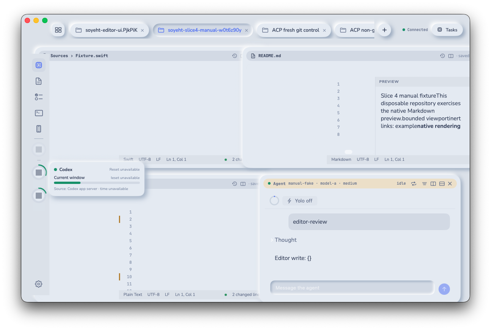

# Slice 4 · native editor and app bar

Date: 2026-09-13. Profile: `Soyeht.next/dev`. License: Apache-2.0. Implementation
head before this report: `2d082d91f333189b5d724d25f682f699a7407cc0`.

Slice 4 is complete. The delivery adds the native Mac editor, bounded usage
readers and rings, language tooling, source-control review, agent participation,
Markdown preview, optional Vim input, the editor CLI, launchd integration, and
measured performance gates. No tag or release was created.

## Delivered scope

ADR 0042 fixed the dependency direction before feature work. `soyeht-editor`,
`soyeht-lsp`, `soyeht-usage`, and `soyeht-vcs` own bounded domain logic. The
engine composes them through ports, the store remains the only SQLite owner,
and ptyd supervises process bytes without interpreting the language protocol.

The protocol additions cover usage, editor files, revisions, viewports,
search, language queries, diffs, formatting, agent review, and their events.
Rust, Swift, and TypeScript types remain generated from one schema. The
surfaces from slices 1–3 remain present and unchanged.

The editor core uses a Unicode-safe piece table, UTF-16 wire positions,
incremental parsing, viewport-limited highlighting, bounded literal search,
and deterministic ranking. The engine validates every initial path through one
canonical workspace boundary and revalidates it before disk effects. Drafts,
conflicts, history, replacements, formatting, and agent review use durable
revision checks and resumable journals.

Language servers use bounded `Content-Length` framing and a closed registry.
One supervised process per workspace and language is adopted across engine
restart. Partial frames and request correlation are checkpointed. Diagnostics
and query results are revision-bound and byte-limited after wire expansion.

Source control uses argument arrays, bounded output, validated relative paths,
and a stable hunk identity. Diff compares `HEAD` with the current buffer.
Agent edits cannot overwrite a human draft or conflict; each accepted or
rejected hunk updates a durable accumulated baseline and re-derives the next
diff. Line comments become one durable task change request.

The shared client holds typed replicas for usage and editor facts. The Mac app
renders the approved 56-point rail, usage rings and detail balloon, native
viewport editor, file tree, navigation palette, editing, conflict/history,
language panels, diff/blame, agent review, Markdown, and optional Vim input.
The iPhone Settings view reads the same usage facts. Shared color tokens and
the font and color gates prevent platform drift.

## Acceptance evidence

| Acceptance | Result | Verification |
| --- | --- | --- |
| 1 · large file and viewport | passed | A measured 100,000-line open, native keystroke-to-pixel, 240 scroll frames, incremental highlighting, and 100,000-line paging stay inside the fixed budgets. |
| 2 · edit and autosave | passed | Durable draft-before-ack, 500 ms autosave, crash recovery, author history, restore, and stale-revision reconciliation are covered. |
| 3 · disk conflict | passed | Clean disk changes reload; dirty changes retain both versions and require explicit conflict resolution without silent overwrite. |
| 4 · navigation and language | passed | Palette, path/content search, bounded replacement, definitions, references, symbols, diagnostics, formatting, supervised restart, and checkpoint recovery are covered. |
| 5 · source control | passed | Current-buffer diff, gutter states, side-by-side view, line blame, path scope, output limits, and stale-revision rejection are covered. |
| 6 · agent participation | passed | Attributed writes, live cursor, per-hunk accept/reject, durable line comments, task feedback, and bounded file-path links are covered. |
| 7 · Vim | passed | The preference is off by default; pure normal/insert/visual rules and the four bounded ex commands are covered. |
| 8 · usage | passed | Five reader states, stored stale readings, per-provider refresh policy, rings, threshold colors, missing-state treatment, detail views, and real-source adapters are covered. |
| 9 · app bar | passed | Client-only view selection, five shortcuts, rail toggle, per-client visibility persistence, and no engine pane side effect are covered. |
| 10 · design fidelity | passed | The implementation PRs were compared directly with Screens 11, 12, and 12b; the final image pairs appear below. |
| 11 · regression and structure | passed | 390 tests, 28 automated acceptances, 33 gate steps, generated files, restricted vocabulary, shared fonts/colors, and all four hardening ratchets passed. |
| 12 · real Mac procedure | passed with recorded risk | Real readers, Swift language server, editing, autosave, diagnostics, diff, history, Markdown, and manual hunk review ran in the Dev profile. The production ACP session risk is recorded below. |

The full reproducible record is
[the slice 4 manual procedure](../manual-acceptance-slice-4.md). The usage
reader outcome is isolated in
[the on-device reader report](usage-reader-ondevice.md).

## Measured performance

The performance gate measures production code paths and native rendering. Its
red and green controls prove the thresholds discriminate at their boundary.

| Measurement | Result | Budget |
| --- | ---: | ---: |
| 100,000-line open | 44.751 ms | less than 150 ms |
| Keystroke to pixel, p95 | 5.011 ms | less than 16 ms |
| Scroll frame, p95 | 5.096 ms | less than 16.667 ms |
| Scroll sample count | 240 frames | at least 60 frames |
| Logical 1 GiB search | 58.649 ms | less than 1,000 ms |

## Usage reader result

The on-device run found one usable reading from each of the three eligible
sources. The dedicated report contains only the allowed provider state and
source. The implementation never persists credentials or raw provider bodies.

## Design comparisons

The reference images were exported directly from the read-only `.pen` frames.
The running images came from the signed Dev app. Numeric usage readings were
removed before the images were versioned; ring geometry and all layout and
theme pixels remain unchanged.

### Native editor · Screen 11

| Approved frame `l6h9Cw` | Running Mac app |
| --- | --- |
|  |  |

**Pass.** The file tree, breadcrumb, editor and companion split, viewport,
gutter geometry, status bar, type families, syntax palette, surfaces, radii,
spacing, and elevation follow the approved frame. The running capture uses the
real native viewport and language-backed file.

### App bar and usage rings · Screen 12

| Approved frame `p4Q8vX` | Running Mac app |
| --- | --- |
|  |  |

**Pass.** The 56-point rail, navigation order, separator, ring cells, provider
glyphs, shared palette, bottom settings action, spacing, and neomorphic track
match the approved frame. The running capture also shows live editor, Markdown,
and agent-review panes.

### Usage detail balloon · Screen 12b

| Approved frame `k9LP4` | Running Mac app |
| --- | --- |
|  |  |

**Pass.** Hover anchors the raised balloon to the ring and preserves the
approved hierarchy, state mark, reset labels, progress track, source line,
radii, shadows, and spacing. The numeric reading is intentionally absent from
the versioned running image.

## Local merge gate

Hosted GitHub Actions remains disabled by project decision. Every PR used the
local gate with the private restricted vocabulary, exact base commit, and final
PR payload. The last implementation gate passed:

- 390 repository test declarations;
- 28 automated acceptances;
- all 33 gate steps, with no removed test, acceptance, or step;
- generated protocol and profile files with no diff;
- Rust formatting, clippy with warnings as errors, build, and workspace tests;
- shared-client tests and unsigned Mac and iPhone builds;
- TypeScript protocol tests;
- zero SQL outside the store;
- zero production panic sites;
- zero production functions above 120 lines, with the maximum at 120; and
- zero raw Mac text fonts or unapproved platform colors.

The report PR repeats the complete gate from the final implementation base.

## Run from scratch on a clean Mac

1. Install the pinned tools from [toolchains](../toolchains.md), including the
   supported language servers and the official ACP adapter. Sign in using each
   provider's own tool; do not copy credentials into Soyeht configuration.
2. Clone the repository, create a dedicated worktree, and run
   `scripts/check_all.sh` with `FORBIDDEN_TERMS` supplied through the
   environment.
3. Build the Rust workspace and install only the new Dev profile with
   `python3 scripts/install_dev.py`. Confirm schema 15 and a connected ptyd.
4. Build and open the development-signed Mac app.
5. Follow [the slice 4 manual procedure](../manual-acceptance-slice-4.md) in a
   disposable Git repository. Record no credential, provider payload, usage
   value, binding, or account identifier.

## Decisions and limits

- ADR 0042 fixes editor, language, usage, source-control, store, ptyd, engine,
  and client boundaries.
- ADR 0043 defines which usage sources are eligible for a read-only reader.
- ADR 0044 defines refresh triggers, all-or-nothing manual batches, and bounded
  backoff.
- ADRs 0045–0049 define UTF-16 coordinates, path ownership, save/conflict
  recovery, search scope, and durable project replacement.
- ADRs 0050–0054 define formatting recovery, current-buffer diff, editor task
  feedback, native Markdown, and bounded Vim input.

The production ACP adapter session did not reach `ready` during the recorded
manual run. Automated ACP coverage remained green and manual editor review was
completed with the deterministic test peer, but the production-session path
must be repeated before a release candidate.

The supervisor keeps closed process receipts for safe idempotent retry. Its
public inventory now returns only live processes, which keeps engine adoption
bounded, but old closed records still occupy Dev-profile storage. A future
maintenance operation should compact them without removing a receipt still
inside its retry horizon.

Parser work and project traversal have byte and result limits but no wall-clock
deadline. Pathological source or file-count inputs can hold an engine worker
longer than ordinary repositories. Cancellation or a work deadline is a
follow-up hardening item.

Search replacement is deliberately fail-closed when an affected file has a
draft, conflict, changed disk content, or changed canonical path. The user must
resolve that state and retry rather than receive a partial overwrite.

## Delivery pull requests

1. [#109 · subsystem boundaries](https://github.com/soyeht/soyeht/pull/109)
2. [#110 · app rail and view switching](https://github.com/soyeht/soyeht/pull/110)
3. [#111 · usage reader investigation](https://github.com/soyeht/soyeht/pull/111)
4. [#112 · usage protocol](https://github.com/soyeht/soyeht/pull/112)
5. [#113 · usage registry](https://github.com/soyeht/soyeht/pull/113)
6. [#114 · persisted usage readings](https://github.com/soyeht/soyeht/pull/114)
7. [#115 · engine usage readers](https://github.com/soyeht/soyeht/pull/115)
8. [#116 · Mac usage rings](https://github.com/soyeht/soyeht/pull/116)
9. [#117 · iPhone usage settings](https://github.com/soyeht/soyeht/pull/117)
10. [#118 · editor protocol](https://github.com/soyeht/soyeht/pull/118)
11. [#119 · incremental editor core](https://github.com/soyeht/soyeht/pull/119)
12. [#120 · editor drafts and history](https://github.com/soyeht/soyeht/pull/120)
13. [#121 · editor file ownership](https://github.com/soyeht/soyeht/pull/121)
14. [#122 · save, conflict, and history](https://github.com/soyeht/soyeht/pull/122)
15. [#123 · search scopes](https://github.com/soyeht/soyeht/pull/123)
16. [#124 · bounded search core](https://github.com/soyeht/soyeht/pull/124)
17. [#125 · safe project search](https://github.com/soyeht/soyeht/pull/125)
18. [#126 · replacement journal](https://github.com/soyeht/soyeht/pull/126)
19. [#127 · recoverable replacement](https://github.com/soyeht/soyeht/pull/127)
20. [#128 · shared usage colors](https://github.com/soyeht/soyeht/pull/128)
21. [#129 · shared color gate](https://github.com/soyeht/soyeht/pull/129)
22. [#130 · editor client replica](https://github.com/soyeht/soyeht/pull/130)
23. [#131 · platform color checks](https://github.com/soyeht/soyeht/pull/131)
24. [#132 · native editor viewport](https://github.com/soyeht/soyeht/pull/132)
25. [#133 · editor navigation palette](https://github.com/soyeht/soyeht/pull/133)
26. [#134 · native editing and autosave](https://github.com/soyeht/soyeht/pull/134)
27. [#135 · conflict and history UI](https://github.com/soyeht/soyeht/pull/135)
28. [#136 · language protocol core](https://github.com/soyeht/soyeht/pull/136)
29. [#137 · supervised language pipes](https://github.com/soyeht/soyeht/pull/137)
30. [#138 · language checkpoints](https://github.com/soyeht/soyeht/pull/138)
31. [#139 · durable language supervision](https://github.com/soyeht/soyeht/pull/139)
32. [#140 · bounded language queries](https://github.com/soyeht/soyeht/pull/140)
33. [#141 · durable formatting](https://github.com/soyeht/soyeht/pull/141)
34. [#142 · live document synchronization](https://github.com/soyeht/soyeht/pull/142)
35. [#143 · Mac language UI](https://github.com/soyeht/soyeht/pull/143)
36. [#144 · source-control core](https://github.com/soyeht/soyeht/pull/144)
37. [#145 · bounded file diff](https://github.com/soyeht/soyeht/pull/145)
38. [#146 · source-control UI](https://github.com/soyeht/soyeht/pull/146)
39. [#147 · hunk resolution core](https://github.com/soyeht/soyeht/pull/147)
40. [#148 · persisted agent review](https://github.com/soyeht/soyeht/pull/148)
41. [#149 · agent file review](https://github.com/soyeht/soyeht/pull/149)
42. [#150 · editor change requests](https://github.com/soyeht/soyeht/pull/150)
43. [#151 · Mac review controls](https://github.com/soyeht/soyeht/pull/151)
44. [#152 · file-path links](https://github.com/soyeht/soyeht/pull/152)
45. [#153 · editor and usage CLI](https://github.com/soyeht/soyeht/pull/153)
46. [#154 · native Markdown preview](https://github.com/soyeht/soyeht/pull/154)
47. [#155 · optional Vim input](https://github.com/soyeht/soyeht/pull/155)
48. [#156 · large-file viewport paging](https://github.com/soyeht/soyeht/pull/156)
49. [#157 · performance budgets](https://github.com/soyeht/soyeht/pull/157)
50. [#158 · launchd editor integrations](https://github.com/soyeht/soyeht/pull/158)
51. [#159 · user-installed CLI path](https://github.com/soyeht/soyeht/pull/159)
52. [#160 · installed Rust tool path](https://github.com/soyeht/soyeht/pull/160)
53. [#161 · live supervisor inventory](https://github.com/soyeht/soyeht/pull/161)

The PR containing this report records the final gate and closes slice 4.
