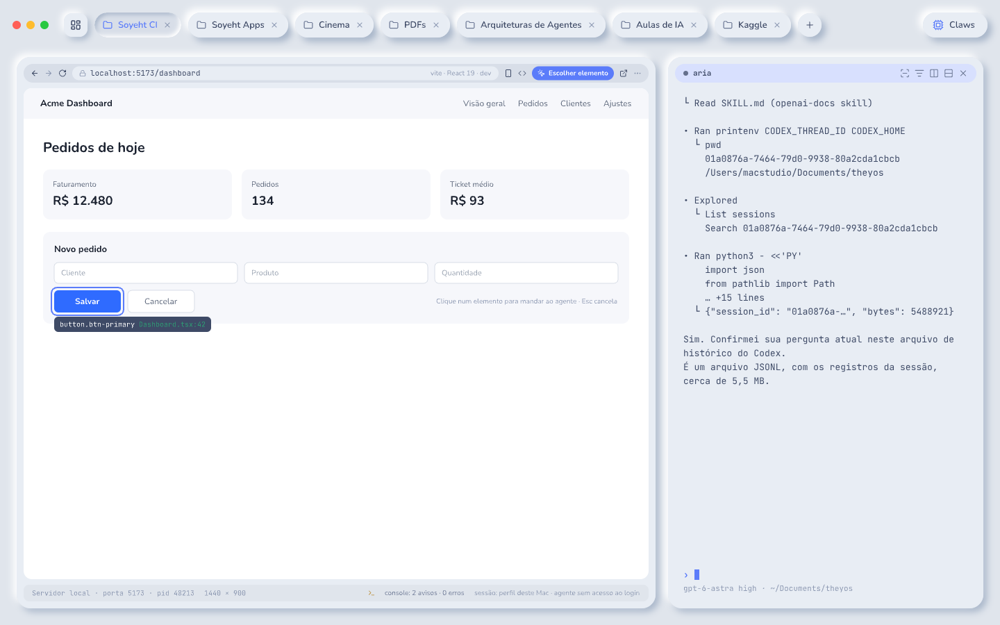
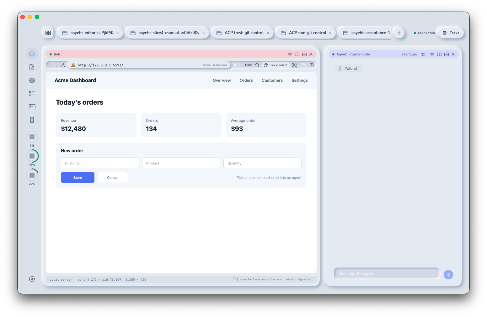
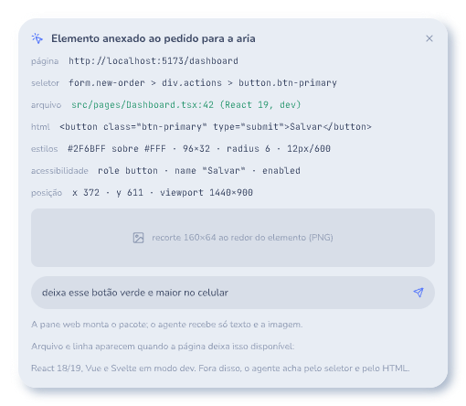
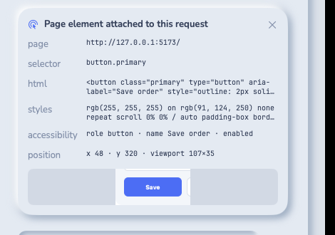
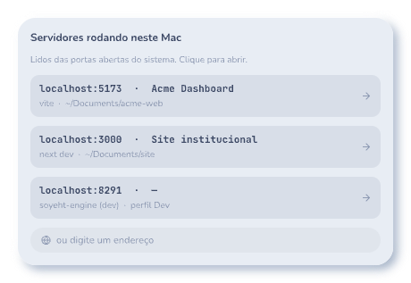
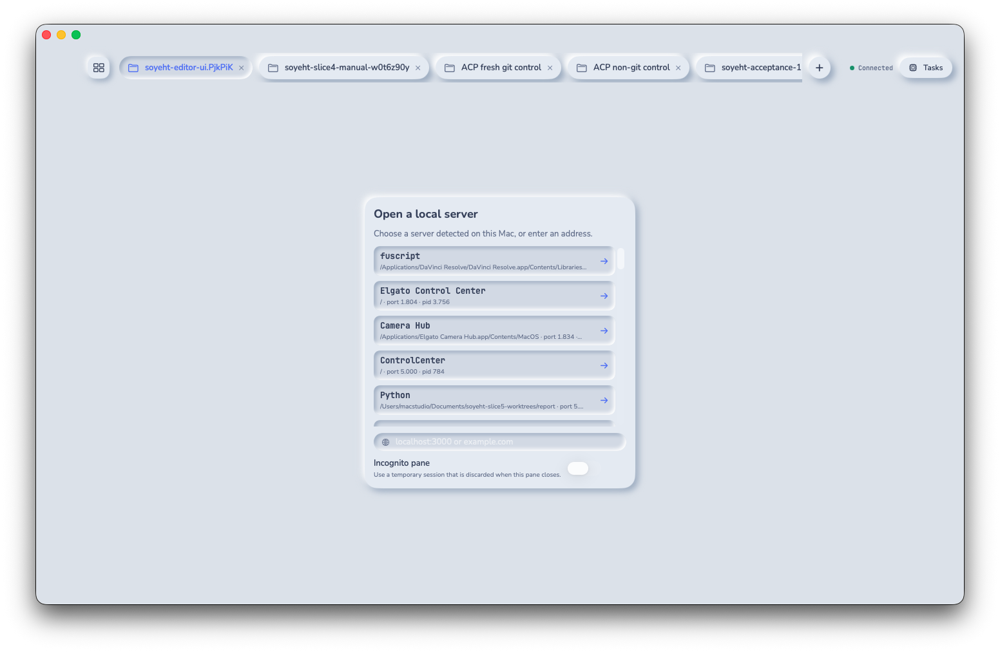

# Slice 5 · browser pane

Date: 2026-09-13. Profile: `Soyeht.next/dev`. License: Apache-2.0. Implementation
head before this report: `981a56060a053c51927f056bccf79ae4ae35e092`.

Slice 5 is complete. The delivery adds the visible Mac browser pane, local
server discovery, bounded page observations and actions, session permission,
incognito storage, element packages for agent prompts, web tools over MCP, and
an iPhone handoff card. Host human mode remains disabled because its required
event and pointer properties cannot both hold on the host Mac. The approved
fallback is recorded below. No tag or release was created.

## Delivered scope

ADR 0055 fixed the dependency direction before feature work. `soyeht-web` owns
bounded pure rules for URL normalization, local-server observations, page
snapshots, element packages, action policy, and console and network rings. The
engine owns durable pane identity, routing, permission and idempotency. The Mac
client owns WebKit and never delegates page rendering to the engine.

The protocol changes are additive. `PaneMode` gained `web`; browser methods,
events, errors, host commands and attachment frames were added. Rust, Swift and
TypeScript types remain generated from one schema. Protocol version remains 1,
and every method and event from slices 1–4 remains present.

The store persists only pane metadata, operation identity and scoped session
permission. Page snapshots, console records, network metadata and browsing
content stay in bounded client memory. Incognito panes use a non-persistent
WebKit data store. Persistent panes share the Dev profile's WebKit data store.

The engine routes a tool request only to the authenticated client hosting the
visible pane. Host loss fails closed. Navigation expires element references.
Person input pauses agent driving until an explicit hand-back. Evaluation and
the first cookie-sending tool call for a domain require explicit permission;
yolo never answers either request.

The page observation layer records bounded metadata. Console output keeps 500
entries. Network output keeps 300 entries and never includes headers or bodies.
Snapshots are capped at 200 KiB, evaluation at 64 KiB, screenshots at 2 MiB,
waits at 60 seconds, element selection at 20 items, and local-server results at
50 items. Every wire response is checked against its final byte budget.

Selected elements carry the bounded selector, DOM path, HTML excerpt, computed
styles, accessibility facts, rectangles, optional framework source fact and a
cropped PNG. The shared attachment assembler commits the text and image as one
ordered group. The image is persisted with the prompt and delivered to the ACP
session without embedding binary data in JSON.

The Mac app provides the approved browser controls, 67/33 browser-and-agent
composition, local-server empty state, element picker, observation panels,
viewport presets, screenshot, session state and agent/person handoff. The
iPhone receives the same pane facts as a title-and-URL card and directs the
person back to the Mac; it does not render the page.

## Acceptance evidence

| Acceptance | Result | Verification |
| --- | --- | --- |
| 1 · human-mode spike | passed as a decision gate | The host design was measured red and a virtual machine with its own browser and input device was selected as the fallback before feature work continued. See the dedicated report. |
| 2 · pane and controls | passed | URL normalization, focus reuse, back/forward/reload, address state, system-open, developer tools, viewport, zoom, find, screenshot and the complete status bar are covered. |
| 3 · local servers | passed | The engine reads listening processes through `PortScanPort`, normalizes and bounds 50 records, publishes changes, and the Mac empty state polls every five seconds with bounded scrolling. |
| 4 · link routing | passed | Typed client rules default local links to an internal web pane and other HTTP(S) links to the system browser, with an explicit saved override. |
| 5 · pick element | passed | Hover, escape, shift-selection, page click suppression, selector/package budgets, cropped image, optional source fact and the ordered agent attachment are covered. |
| 6 · agent tools | passed | Bound MCP tools drive only the visible hosted pane; stale references and person takeover fail closed; evaluation has separate permission; console and network responses expose metadata only. |
| 7 · session and privacy | passed | Persistent and incognito stores are separated; domain grants and pending permission survive restart; yolo exclusions hold; page observations have no database schema surface. |
| 8 · host human mode | not applicable after acceptance 1 | The conditional host implementation was not built. The virtual-machine fallback requires a future objective and must pass the complete spike before human mode can be enabled. |
| 9 · design fidelity | passed, pending reviewer confirmation | Real framebuffer captures are paired below with Screens 13, 13b and 13c. The final browser-and-agent split was corrected to the approved 67/33 composition before capture. |
| 10 · iPhone | passed | Shared-client tests and the iPhone build prove the bounded title-and-URL handoff card and the absence of page rendering. |
| 11 · regression and structure | passed | 462 tests, 32 automated acceptances and all 34 gate steps passed with protocol generation, Rust, Mac, iPhone, TypeScript, hardening, font, color and restricted-vocabulary checks. |

The human-mode decision and measurements are in
[the spike report](human-mode-spike.md).

## Design comparisons

The reference images were exported directly from the read-only approved design.
The running images are real framebuffer captures from the final Dev build. The
test page contains no account or external content.

### Browser and agent · Screen 13

| Approved frame `cqz1Z` | Running Mac app |
| --- | --- |
|  |  |

**Pass.** The browser occupies the left two-thirds and the agent companion the
right third. Navigation chrome, address field, local state, page surface,
element-picker action, status row, pane surfaces, radii, spacing, type and
elevation follow the approved frame. The live page uses English fixture content;
the reference uses review copy in Portuguese.

### Picked element package · Screen 13b

| Approved frame `LMPTq` | Running Mac app |
| --- | --- |
|  |  |

**Pass.** The raised attachment card preserves the approved information order:
page, selector, HTML, styles, accessibility, position and image crop. The card
was captured after a real pointer selection in the visible WebKit page.

### Local-server empty state · Screen 13c

| Approved frame `F4E5sy` | Running Mac app |
| --- | --- |
|  |  |

**Pass.** The centered raised panel, heading, explanatory line, server rows,
arrow actions, address field and incognito control follow the approved visual
language. The running list contains real Dev-machine observations and is
bounded in a scrolling region so a full 50-item response cannot grow the sheet.

## Local merge gate

Hosted GitHub Actions remains disabled by project decision. Every PR used the
local gate with the private restricted vocabulary and the exact implementation
base. The final implementation gate passed:

- 462 repository test declarations;
- 32 automated acceptances;
- all 34 gate steps, with no removed test, acceptance or step;
- generated protocol and profile files with no diff;
- protocol version 1, with 703 Swift and 710 TypeScript message checks;
- Rust formatting, clippy with warnings as errors, build and workspace tests;
- 55 shared-client tests and unsigned Mac and iPhone builds;
- launchd end-to-end suites for terminal, agents, tasks, editor and web;
- zero SQL outside the store;
- zero production panic sites;
- zero production functions above 120 lines, with the maximum at 120; and
- zero raw Mac text fonts or unapproved Mac/iPhone colors.

The report PR repeats the complete gate from the final implementation base.

## Run from scratch on a clean Mac

1. Install the pinned tools from [toolchains](../toolchains.md), Xcode and the
   supported ACP adapter. Sign in through the adapter itself; do not copy a
   credential into Soyeht configuration.
2. Clone the repository, create a dedicated worktree, and run
   `scripts/check_all.sh` with `FORBIDDEN_TERMS` supplied through the
   environment.
3. Build the Rust workspace and install only the new Dev profile with
   `uv run python scripts/install_dev.py`. Confirm schema 19 and connected engine and
   ptyd services.
4. Build and open the development-signed Mac app. Start a disposable local HTTP
   server and create a web pane from its detected row or address.
5. Exercise navigation, resize, find, screenshot, console/network panels,
   element selection, agent attachment, permission, incognito and person
   handoff. Close the disposable workspace and server afterward.
6. Build the iPhone app and confirm that the same pane appears only as the Mac
   handoff card.

## Decisions and limits

- ADR 0055 records the browser boundaries, host routing, human-mode failure and
  virtual-machine fallback.
- ADR 0056 separates transient host traffic from the durable event cursor.
- ADRs 0057–0060 record page-observation privacy, attachment framing, selected
  element prompt budgets and the public WebKit inspector entry.

Human mode is disabled on the host Mac. The fallback is an isolated virtual
machine with its own input device and browser. It is outside this slice. It must
repeat all local checks plus the signed-in read-only site check before the
feature can be enabled.

The browser operates only in a visible Soyeht web pane. It does not drive the
person's everyday browser, import cookies, create public tunnels, intercept
request bodies, install extensions, record sessions, export PDF or solve an
authentication challenge.

The server detector reports listening processes visible to the engine and may
include unrelated local services. It publishes bounded process metadata only.
The UI does not imply that every detected listener belongs to the current
workspace.

Page observations are intentionally transient. A restart clears console,
network and DOM references while retaining pane identity and permitted session
state. Tools must reacquire a snapshot after navigation or reconnect.

## Delivery pull requests

1. [#164 · slice objective](https://github.com/soyeht/soyeht/pull/164)
2. [#165 · human-mode spike](https://github.com/soyeht/soyeht/pull/165)
3. [#166 · subsystem boundaries](https://github.com/soyeht/soyeht/pull/166)
4. [#167 · browser protocol](https://github.com/soyeht/soyeht/pull/167)
5. [#168 · bounded browser core](https://github.com/soyeht/soyeht/pull/168)
6. [#169 · scoped session grants](https://github.com/soyeht/soyeht/pull/169)
7. [#170 · local-server discovery](https://github.com/soyeht/soyeht/pull/170)
8. [#171 · web pane persistence](https://github.com/soyeht/soyeht/pull/171)
9. [#172 · bounded host routing](https://github.com/soyeht/soyeht/pull/172)
10. [#173 · durable web navigation](https://github.com/soyeht/soyeht/pull/173)
11. [#174 · transient host events](https://github.com/soyeht/soyeht/pull/174)
12. [#175 · authenticated host state](https://github.com/soyeht/soyeht/pull/175)
13. [#176 · bounded host commands](https://github.com/soyeht/soyeht/pull/176)
14. [#177 · durable web permissions](https://github.com/soyeht/soyeht/pull/177)
15. [#178 · engine permission policy](https://github.com/soyeht/soyeht/pull/178)
16. [#179 · bound MCP web tools](https://github.com/soyeht/soyeht/pull/179)
17. [#180 · client host routing](https://github.com/soyeht/soyeht/pull/180)
18. [#181 · Mac WebKit host](https://github.com/soyeht/soyeht/pull/181)
19. [#182 · browser navigation chrome](https://github.com/soyeht/soyeht/pull/182)
20. [#183 · local-server empty state](https://github.com/soyeht/soyeht/pull/183)
21. [#184 · hosted viewport resize](https://github.com/soyeht/soyeht/pull/184)
22. [#185 · structured page actions](https://github.com/soyeht/soyeht/pull/185)
23. [#186 · bounded page evaluation](https://github.com/soyeht/soyeht/pull/186)
24. [#187 · bounded page observations](https://github.com/soyeht/soyeht/pull/187)
25. [#188 · attachment frame lifecycle](https://github.com/soyeht/soyeht/pull/188)
26. [#189 · attachment transfer validation](https://github.com/soyeht/soyeht/pull/189)
27. [#190 · binary attachment routing](https://github.com/soyeht/soyeht/pull/190)
28. [#191 · screenshot capture](https://github.com/soyeht/soyeht/pull/191)
29. [#192 · MCP screenshot images](https://github.com/soyeht/soyeht/pull/192)
30. [#193 · grouped attachment assembly](https://github.com/soyeht/soyeht/pull/193)
31. [#194 · prompt image persistence](https://github.com/soyeht/soyeht/pull/194)
32. [#195 · ACP image blocks](https://github.com/soyeht/soyeht/pull/195)
33. [#196 · durable prompt images](https://github.com/soyeht/soyeht/pull/196)
34. [#197 · element picker and composer](https://github.com/soyeht/soyeht/pull/197)
35. [#198 · link routing preference](https://github.com/soyeht/soyeht/pull/198)
36. [#199 · browser controls](https://github.com/soyeht/soyeht/pull/199)
37. [#200 · console and network UI](https://github.com/soyeht/soyeht/pull/200)
38. [#201 · incognito option](https://github.com/soyeht/soyeht/pull/201)
39. [#202 · agent/person handoff](https://github.com/soyeht/soyeht/pull/202)
40. [#203 · iPhone web handoff](https://github.com/soyeht/soyeht/pull/203)
41. [#204 · launchd web acceptances](https://github.com/soyeht/soyeht/pull/204)
42. [#205 · bounded server list](https://github.com/soyeht/soyeht/pull/205)
43. [#206 · browser and agent split](https://github.com/soyeht/soyeht/pull/206)

The report PR records the final gates and design evidence for slice 5.
