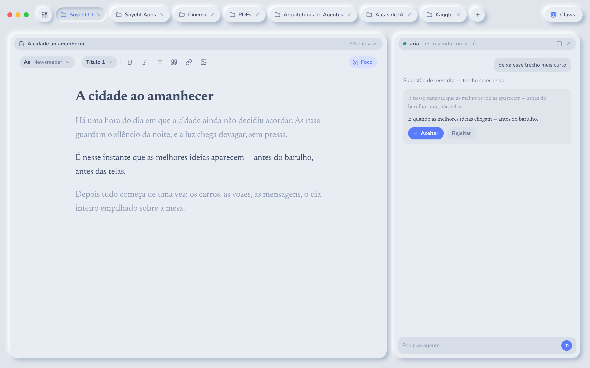
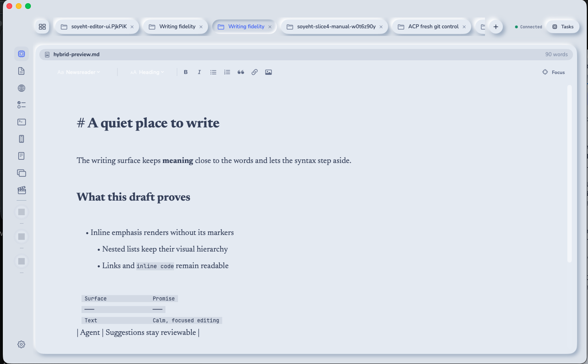
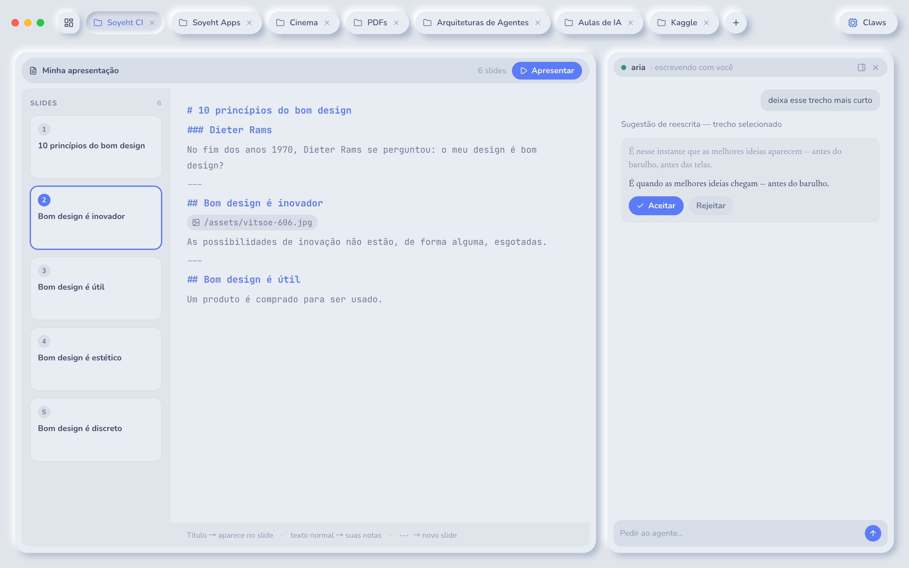
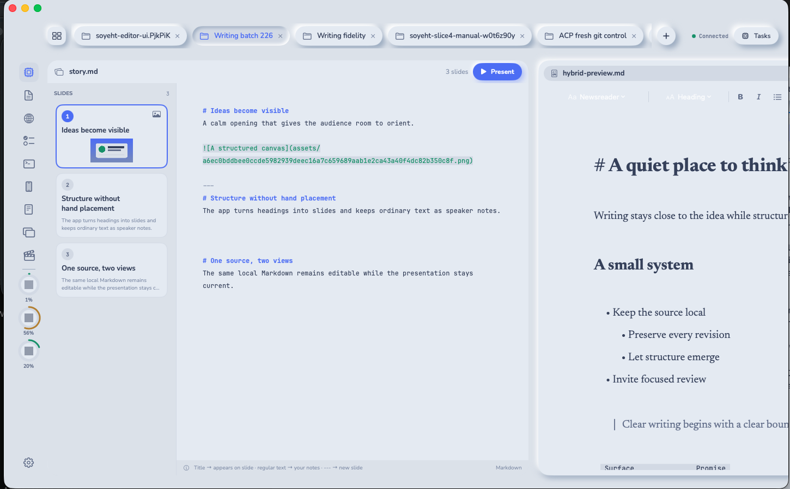
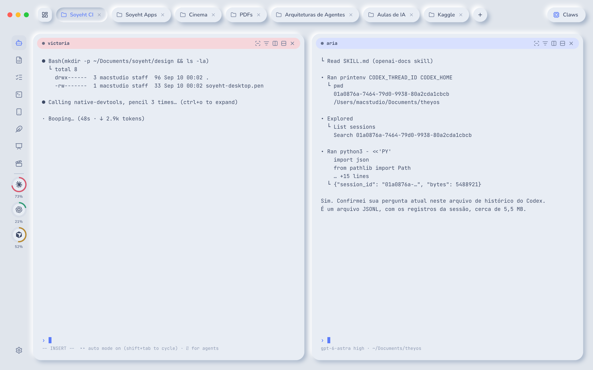
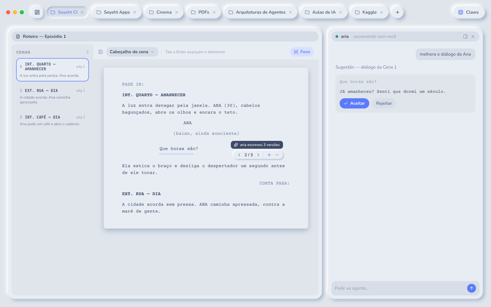
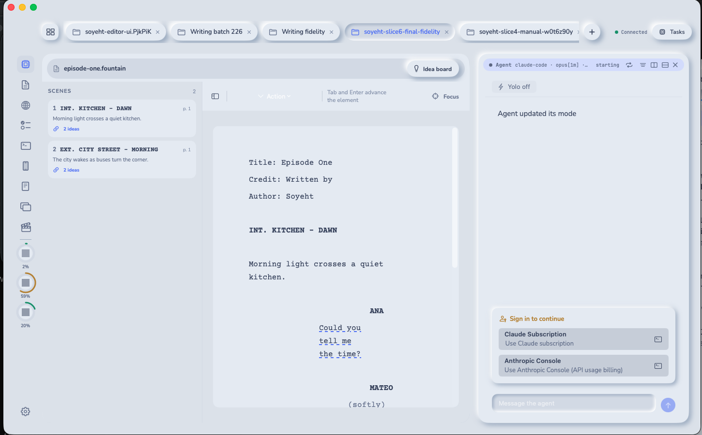
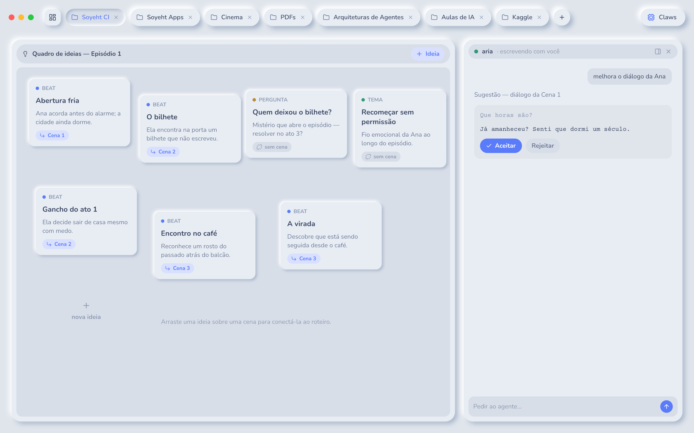
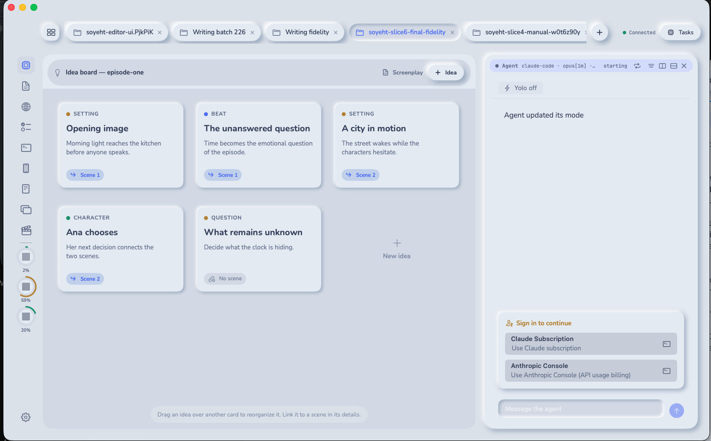

# Slice 6 · writing editor

Date: 2026-09-14. Profile: `Soyeht.next/dev`. License: Apache-2.0. Implementation
head before this report: `965466e13c2247fcb567539c391a4fda3cf4fbab`.

Slice 6 is complete. The delivery adds one native writing mode over the existing
owned-file editor path, with text, presentation and screenplay document kinds,
three bounded writing sections, agent suggestions, durable screenplay variants
and a linked idea board. No tag or release was created.

## Delivered scope

The measured rendering spike selected native TextKit. It rendered the bounded
viewport of a 100,000-line document with a 1.77 ms active-line p95, while the
web candidate measured 99.7 ms and crossed a script boundary for every change.
ADR 0061 fixed the dependency direction before feature work: the client owns
prose layout, the engine owns document identity and routes operations, and the
store remains the sole database owner.

`soyeht-writing` contains the bounded pure rules for section paths, Markdown
formatting and hybrid projection, slide segmentation, Fountain parsing,
SmartType facts, screenplay line variants and idea-card links. It depends only
on `soyeht-protocol`. The engine reuses file ownership, revision checks,
autosave, conflict handling, history, durable formatting and change-request
delivery from ADRs 0046, 0047, 0050 and 0052. There is no second file writer.

The wire changes are additive. `PaneMode` gained `writing`, with a closed
`WritingKind` for text, presentation and screenplay. Writing methods, events,
errors and limits were added without removing earlier surfaces. Rust, Swift and
TypeScript types remain generated from one schema. Protocol version remains 1.

Writing documents are regular local files under separate `Writing/Texts`,
`Writing/Presentations` and `Writing/Screenplays` roots. Creation is journalled
and idempotent, uses exclusive file creation, rejects symlinks and path escape,
and recovers only a matching empty target. Section lists, slide counts, scene
counts, elements, cards, links, variants, images and sidecars are bounded.

The text surface renders Markdown inline with raw syntax only on the active
line. It includes the approved Newsreader face, focus mode and a format toolbar
that writes valid source for headings, bold, italic, list, quote, link and
image. Tables use aligned themed columns without altering source text or UTF-16
positions.

Presentation is a second view of the same Markdown file. A thematic break or
three Returns starts a slide, headings become shown content and ordinary text
becomes speaker notes. Thumbnails and presentation mode share the derived slide
structure. Pasted and dragged PNG images use immutable content-addressed assets,
bounded binary frames and revision-checked reads; the client never receives a
workspace filesystem capability.

The screenplay surface keeps canonical Fountain text and derives its ordered
elements, scenes and SmartType facts. Courier Prime is bundled under its OFL
license. Tab and Enter advance through a closed element machine. Agent-generated
alternate takes live in a bounded durable sidecar; the agent may add an
alternate, while only a person may request, select or remove one. The canonical
Fountain contains only the selected line.

Idea cards and their scene links share the screenplay sidecar. Cards are
bounded, ordered, revision-checked and visible from both the board and scene
navigator. Dragging reorders cards; the card details choose an optional scene.
The writer can open the ordinary agent companion beside every writing surface.
Agent rewrites and comments reuse the same durable per-hunk accept/reject view
as the code editor.

## Acceptance evidence

| Acceptance | Result | Verification |
| --- | --- | --- |
| 1 · spike and boundaries | passed | The native and web candidates were measured before feature work. ADR 0061 records one writing mode, pure-core boundaries and reuse of the owned-file lifecycle. |
| 2 · text | passed | A local Markdown file opens, edits and autosaves through the owned-file path. Hybrid preview, focus, font selection and every closed toolbar format are covered by pure-core, client and launchd tests. |
| 3 · sections and rail | passed | Texts, Presentations and Screenplays enumerate separate bounded roots, nested folders remain inside their section, creation is durable and idempotent, and cross-section paths are refused. |
| 4 · presentation | passed | Both slide separators, heading/content separation, thumbnails, present layout and content-addressed pasted images are covered; the launchd suite proves segmentation and image persistence. |
| 5 · screenplay | passed | Fountain parsing, all seven elements, scene navigation, SmartType and Tab/Enter advance are covered. Agent-authored variants are person-selected, bounded and durable across restart. |
| 6 · idea board | passed | Cards create, update, delete and reorder with revision checks; scene links are bidirectional and the launchd suite proves an identical board after engine restart. |
| 7 · agent assist | passed | Writing panes reuse the existing durable agent review bar and change-request path for comments and per-hunk accept/reject on the same owned file. |
| 8 · design fidelity | passed, reviewer confirmed | Real framebuffer captures are paired below with Screens 14, 15, 17, 18 and 19. The reviewer confirmed every pair in the running Dev app. |
| 9 · fonts and colors | passed | Newsreader and Courier Prime are bundled with licenses and admitted by the font gate; all UI colors come from the shared theme and the Mac/iPhone color gate is clean. |
| 10 · regression and structure | passed | 497 test declarations, 37 automated acceptances and all 35 gate steps passed. Protocol generation, Rust, Mac, iPhone, TypeScript, performance, four hardening ratchets, font/color gates and restricted-vocabulary scan are green. |

The rendering measurements and boundary decision are in
[the prose-rendering spike](prose-rendering-spike.md) and
[ADR 0061](../adr/0061-writing-surface-boundaries.md).

## Design comparisons

The reference images were exported directly from the read-only approved design.
The running images are real framebuffer captures from signed Dev builds. Review
copy in the reference is Portuguese; the shipped UI is English and prepared for
a later localization pass.

### Text · Screen 14

| Approved frame `aiVQb` | Running Mac app |
| --- | --- |
|  |  |

**Pass.** File header, word count, format toolbar, focus control, reading column,
Newsreader typography, spacing, radii and elevation follow the frame. The live
fixture also proves headings, emphasis, nested lists, inline and fenced code,
quotes and an aligned Markdown table. Inactive lines hide syntax markers while
the active line exposes its source.

### Presentation · Screen 15

| Approved frame `VQ8hk` | Running Mac app |
| --- | --- |
|  |  |

**Pass.** The 236-point slide rail, bounded thumbnails, selected outline,
editable Markdown source, footer explanation and Present action follow the
frame. The first live thumbnail renders a real content-addressed pasted image.

### Writing rail · Screen 17

| Approved frame `e0Zlg` | Running Mac app |
| --- | --- |
|  |  |

**Pass.** The left application rail contains the separate Texts, Presentations
and Screenplays entries in the approved order and visual system. Each entry
opens its own bounded section list without changing the active pane lifecycle.

### Screenplay · Screen 18

| Approved frame `DFqGr` | Running Mac app |
| --- | --- |
|  |  |

**Pass.** The collapsible scene navigator, page labels and linked-card counts,
element toolbar, focus control and Courier Prime sheet follow the frame. The
live dialogue has the approved dotted underline; pointer hover reveals the
agent-authorship tag and `‹ 2/3 ›`, add and remove controls.

### Idea Board · Screen 19

| Approved frame `Y7sdbI` | Running Mac app |
| --- | --- |
|  |  |

**Pass.** Category dots, raised cards, title and note hierarchy, scene pills,
new-card affordance, open canvas and agent companion follow the frame. The live
board uses the card detail to assign a scene and drag to reorder cards. Both
facts persist in the shared screenplay sidecar.

## Local merge gate

Hosted GitHub Actions remains disabled by project decision. Every PR used the
local gate with the private restricted vocabulary and the exact implementation
base. The final implementation gate passed:

- 497 repository test declarations;
- 37 automated acceptances, including five launchd writing flows;
- all 35 gate steps, with no removed test, acceptance or step;
- generated protocol and profile files with no diff;
- protocol version 1, with 772 Swift and 779 TypeScript message checks;
- Rust formatting, clippy with warnings as errors, build and workspace tests;
- 64 shared-client tests and unsigned Mac and iPhone builds;
- launchd end-to-end suites for terminal, agents, tasks, editor, web and writing;
- measured editor performance, including 914 painted editor pixels;
- zero SQL outside the store;
- zero production panic sites;
- zero production functions above 120 lines, with the maximum at 120; and
- zero raw Mac text fonts or unapproved Mac/iPhone colors.

The report PR repeats the complete gate from the final implementation base.

## Run from scratch on a clean Mac

1. Install the pinned toolchains and Xcode, clone the repository and create a
   dedicated worktree. Run `scripts/check_all.sh` with `FORBIDDEN_TERMS`
   supplied through the environment.
2. Build the Rust workspace and install only the Dev profile with
   `python3 scripts/install_dev.py`. Confirm schema 20 and connected engine and
   ptyd services.
3. Build and open the development-signed Mac app. Create a disposable workspace
   with the three `Writing` section folders.
4. Create and open a text document. Exercise hybrid preview, the format toolbar,
   focus, font choice, autosave, conflict/history and agent review.
5. Create a presentation. Confirm both separator rules, thumbnails, notes,
   pasted-image persistence and presentation mode.
6. Create a Fountain screenplay. Exercise the scene navigator, element advance,
   SmartType, agent-authored variants and the person-only selected line.
7. Open the Idea Board, create and reorder cards, assign scenes and confirm the
   same links from the scene navigator after an engine restart.
8. Close the disposable workspace and remove its files.

## Decisions and limits

- ADR 0061 records the native writing surface, subsystem boundaries, one writing
  mode with a closed kind, and reuse of the editor ownership lifecycle.
- ADR 0062 records journalled document creation and immutable content-addressed
  writing assets. The repository contains two narrowly scoped ADR 0062 files;
  their titles distinguish these independent decisions.
- ADR 0063 records revision-checked bounded asset reads over attachment frames.

Writing documents remain plain Markdown or Fountain. Presentation layout,
screenplay layout and the Idea Board are client views over bounded derived facts.
There is no engine-side prose renderer, duplicate filesystem writer or database
copy of document text.

The board uses drag to reorder and a card-detail sheet to assign a scene. The
approved frame suggested a direct drag-to-scene gesture; the reviewer recorded
this as an interaction choice for product review, not a fidelity failure.

The slice does not add media generation, general knowledge linking, real-time
multi-human collaboration, plugins, cloud sync, export formats or language
switching. Screenplay sidecars are deliberately limited to scene links and line
variants so later media tooling can extend them without changing canonical
Fountain text.

The reconnect reliability fix in PR #227 parks a language server for a closed
pane before supervisor reconciliation. The final two-screen fidelity session
ran without timeout modals or lost panes.

## Delivery pull requests

1. [#208 · slice objective](https://github.com/soyeht/soyeht/pull/208)
2. [#209 · native rendering spike and boundaries](https://github.com/soyeht/soyeht/pull/209)
3. [#210 · writing protocol](https://github.com/soyeht/soyeht/pull/210)
4. [#211 · bounded writing core](https://github.com/soyeht/soyeht/pull/211)
5. [#212 · durable writing sidecars](https://github.com/soyeht/soyeht/pull/212)
6. [#213 · engine writing structure](https://github.com/soyeht/soyeht/pull/213)
7. [#214 · durable creation intent](https://github.com/soyeht/soyeht/pull/214)
8. [#215 · safe document creation](https://github.com/soyeht/soyeht/pull/215)
9. [#216 · owned-file Markdown formatting](https://github.com/soyeht/soyeht/pull/216)
10. [#217 · typed writing replica](https://github.com/soyeht/soyeht/pull/217)
11. [#218 · hybrid text surface](https://github.com/soyeht/soyeht/pull/218)
12. [#219 · writing sections and rail](https://github.com/soyeht/soyeht/pull/219)
13. [#220 · aligned table preview](https://github.com/soyeht/soyeht/pull/220)
14. [#221 · presentation surface](https://github.com/soyeht/soyeht/pull/221)
15. [#222 · bounded image format request](https://github.com/soyeht/soyeht/pull/222)
16. [#223 · content-addressed image write](https://github.com/soyeht/soyeht/pull/223)
17. [#224 · bounded asset-read protocol](https://github.com/soyeht/soyeht/pull/224)
18. [#225 · bounded asset transport](https://github.com/soyeht/soyeht/pull/225)
19. [#226 · presentation image paste and rendering](https://github.com/soyeht/soyeht/pull/226)
20. [#227 · reconnect reliability](https://github.com/soyeht/soyeht/pull/227)
21. [#228 · durable screenplay variants](https://github.com/soyeht/soyeht/pull/228)
22. [#229 · screenplay interaction model](https://github.com/soyeht/soyeht/pull/229)
23. [#230 · screenplay surface](https://github.com/soyeht/soyeht/pull/230)
24. [#231 · durable Idea Board](https://github.com/soyeht/soyeht/pull/231)
25. [#232 · Idea Board surface](https://github.com/soyeht/soyeht/pull/232)
26. [#233 · writing agent review controls](https://github.com/soyeht/soyeht/pull/233)
27. [#234 · launchd writing acceptances](https://github.com/soyeht/soyeht/pull/234)

The report PR records the final gates and reviewer-confirmed design evidence for
slice 6.
